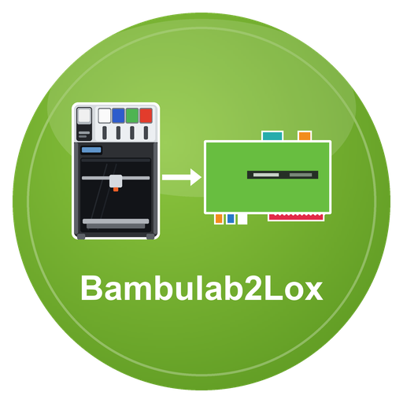

# Bambulab2Lox – LoxBerry-Plugin

**Version 0.1.0** · Benötigt LoxBerry 4 (PHP ≥ 8.4) · [Changelog](CHANGELOG.md)

Dokumentation: [docs/wiki/Home.md](docs/wiki/Home.md)

Liest **Bambu-Lab-Drucker** über deren lokalen MQTT-Broker (TLS, Port 8883, Access Code) aus und veröffentlicht Zustand, Fortschritt, Temperaturen, Lüfter, Lichter, AMS und Fehler per MQTT am LoxBerry-Broker (→ MQTT-Gateway → Loxone). Dazu Befehle aus Loxone (Licht, Pause, Fortsetzen, Geschwindigkeit, Stopp), ab Werk gesperrt und mit Quittung. Ersetzt den ioBroker-Adapter `bambulab`. Nichts läuft über die Bambu-Cloud.

**Geprüft ist bisher nur ein H2C.** X1, X1C, X1E, P1P, P1S, A1, A1 mini und die anderen H2-Modelle sind nach der inoffiziellen Beschreibung des Druckerprotokolls umgesetzt (Spezifikation: [SPEZIFIKATION.md](SPEZIFIKATION.md)).

## Voraussetzungen am Drucker
- **Auslesen** geht am H2C **ohne LAN-Modus und ohne Entwicklermodus**; Seriennummer und **Access Code** stehen am Drucker unter Einstellungen → WLAN/Netzwerk. Bei anderen Modellen kann der LAN-Modus nötig sein (er schaltet die Bambu-Cloud für diesen Drucker ab; Bambu Studio im selben Netz und weitere Clients, mindestens vier gleichzeitig getestet, funktionieren parallel).
- **Schalten:** Ohne Entwicklermodus ist **nur das Licht** schaltbar. Für **Pause, Fortsetzen, Geschwindigkeit und Stopp** verlangt die Firmware den **Entwicklermodus** (Einstellungen → WLAN/Netzwerk → Nur LAN-Modus → Entwicklermodus; von Bambu nicht offiziell unterstützt, schaltet die Cloud ab). Lehnt der Drucker solche Befehle ab, zeigt das Plugin einen Hinweis.

## Installation
1. `bash build.sh` → `bambulab2lox-<version>.zip` (oder ZIP von den Releases)
2. In LoxBerry → Plugin-Verwaltung → ZIP installieren.
3. Plugin öffnen, Reiter „Drucker“: Host/IP, Seriennummer und Access Code eintragen, **Aktiv** anhaken, speichern.
4. Im MQTT Gateway das Abo `bambulab/#` eintragen (Gateway V1 über die Abo-Datei des Plugins, **Gateway V2 von Hand**; der Reiter „MQTT“ zeigt es).
5. Reiter „Test“ → „Sofort abrufen“ und „Selbstprüfung“. Werte erscheinen unter `bambulab/<name>/*`.

**Immer das neueste Release:** `https://github.com/ricten/Bambulab2Lox/releases/latest/download/bambulab2lox.zip` (ZIP ohne Version im Namen). **Automatische Updates:** Neue Installationen stehen in der Plugin-Verwaltung auf „Releases“, LoxBerry prüft täglich die `release.cfg` im Repository und installiert neuere Versionen selbst (Details: [docs/wiki/Installation.md](docs/wiki/Installation.md)).

## Topics (Auszug)
`bambulab/drucker1/status_text`, `zustand/druckt|pausiert|fertig|abgebrochen|fehler`, `fortschritt_prozent`, `restzeit_min`, `schicht`, `duese_c`, `bett_c`, `kammer_c`, `licht/kammer`, `ams/<n>/slot/<k>/typ`, `fehler/hms_text`, `verbunden`, `bambulab/status/ok|zaehler|ts`.
Befehle: `bambulab/befehl/<name>/licht_kammer|licht_kammer2|licht_arbeit|pause|fortsetzen|geschwindigkeit|stopp`, Quittung unter `…/quittung`.
Vollständige Liste: [docs/wiki/MQTT-Topics.md](docs/wiki/MQTT-Topics.md).

## MQTT-Broker
Standard ist der Broker des LoxBerry (Zugangsdaten verwaltet LoxBerry). Alternativ lässt sich im Reiter „MQTT“ ein eigener Broker eintragen. Die Verbindung zum Drucker ist davon unabhängig.

## Entwicklung
- Tests: `php tests/run.php` (unter Windows ohne `php.ini`: `php -d extension_dir=<php>/ext -d extension=openssl tests/run.php`, der Fake-Drucker braucht TLS)
- Details und Regeln: [CLAUDE.md](CLAUDE.md), [docs/wiki/Entwicklung.md](docs/wiki/Entwicklung.md)

## Lizenz
MIT, siehe [LICENSE](LICENSE). Bambu Lab ist eine Marke der Shenzhen Tuozhu Technology Co., Ltd.; dieses Plugin ist inoffiziell.
