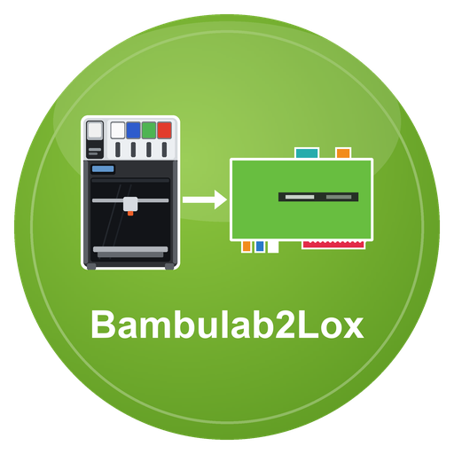

# Bambulab2Lox

**Bambulab2Lox** ist ein LoxBerry-Plugin, das **Bambu-Lab-Drucker** über deren lokalen MQTT-Broker ausliest und die Werte an den MQTT-Broker des LoxBerry veröffentlicht. Über das LoxBerry-MQTT-Gateway gelangen sie an den Loxone Miniserver. Es nimmt außerdem Befehle aus Loxone an (Licht, Pause, Fortsetzen, Geschwindigkeit, Stopp). Es ersetzt den ioBroker-Adapter `bambulab`.

> **Stand: Beta (0.1.0).** Geprüft ist bisher nur ein **H2C** (Auslesen, Lichter, Geschwindigkeit, Pause, Fortsetzen, Stopp, HMS-Klartext). X1, X1C, X1E, P1P, P1S, A1, A1 mini und die anderen H2-Modelle sind nach der inoffiziellen Beschreibung des Druckerprotokolls umgesetzt, aber nicht an echten Geräten ausprobiert. Rückmeldungen sind willkommen.

## Was kann das Plugin?

- Liest bis zu **8 Drucker**, jeden unter eigenem Namen (`bambulab/<name>/…`); die Verbindung geht direkt zum Drucker (TLS, Port 8883), **nichts über die Bambu-Cloud**
- **Zustand:** Leerlauf, Vorbereitung, Druck, Pause, fertig, abgebrochen, Fehler – als Text und als Schalter 0/1
- **Druck:** Fortschritt, Restzeit, Schicht, Auftragsname, Geschwindigkeit
- **Temperaturen und Lüfter:** Düse, Bett, Kammer; H2: je Düse, aktive Düse, Düsenwechsel und die Düsen im Halter
- **Licht, WLAN, Fehler:** Lichter, Signalstärke, Fehlercode und HMS-Meldungen als Code; auf Wunsch (Option, braucht Internet) der **Klartext** aus der öffentlichen Textliste von Bambu
- **AMS:** Temperatur, Feuchte, Slots mit Filamenttyp, Farbe und Restmenge, aktiver Slot, externe Spule(n)
- **Befehle aus Loxone** (ab Werk gesperrt, je Drucker in drei Stufen freizugeben, mit Quittung): Kammerlicht, zweites Kammerlicht, Arbeitslicht, Pause, Fortsetzen, Geschwindigkeit, Stopp
- Veröffentlicht nur **Änderungen** (alle 5 Minuten alle Werte); ein ausgeschalteter Drucker ist kein Fehler
- MQTT-Broker des LoxBerry oder **eigener Broker**
- Lebenszeichen `bambulab/status/ok|zaehler|ts` für die Ausfallerkennung in Loxone, Healthcheck
- Weboberfläche mit Druckerliste, MQTT-Reiter (Gateway-Abo), Topic- und Befehlstabelle, Selbstprüfung und Log

## Seiten

1. [Installation](Installation.md)
2. [Konfiguration](Konfiguration.md)
3. [MQTT-Topics](MQTT-Topics.md)
4. [Loxone-Anbindung](Loxone-Anbindung.md)
5. [Fehlersuche](Fehlersuche.md)
6. [Entwicklung](Entwicklung.md)

## Voraussetzungen

- LoxBerry ≥ 4.0 mit aktivem MQTT-Broker (Mosquitto) und MQTT-Gateway (oder eigener Broker)
- PHP ≥ 8.4 mit der Erweiterung `openssl` (bei LoxBerry 4 dabei)
- Ein Bambu-Lab-Drucker im selben Netz. Am H2C geht das Auslesen ohne LAN- und Entwicklermodus; bei anderen Modellen kann der **LAN-Modus** nötig sein. Für Pause, Fortsetzen, Geschwindigkeit und Stopp ist der **Entwicklermodus** nötig, ohne ihn ist nur das Licht schaltbar (siehe [Installation](Installation.md))

## Lizenz

MIT, siehe [LICENSE](../../LICENSE). Bambu Lab ist eine Marke der Shenzhen Tuozhu Technology Co., Ltd.; dieses Plugin ist inoffiziell und nicht von Bambu Lab.
